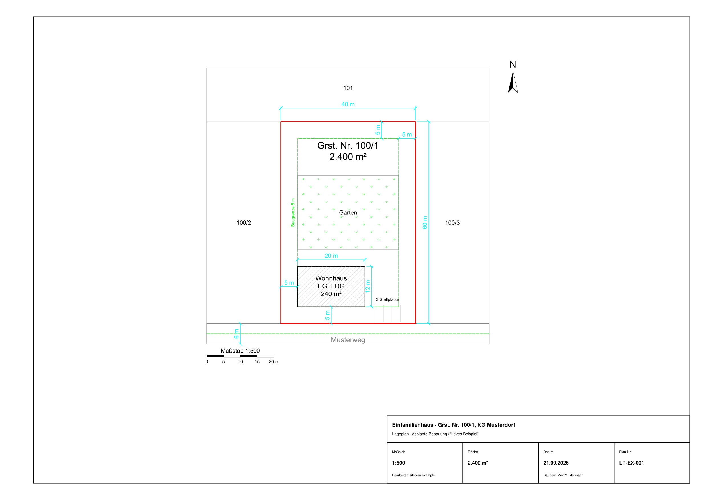

# siteplan

Scaled site plans — a **true-to-scale DXF** plus a **printable A4–A0 PDF** — from a
small JSON file of plain measurements in metres, or straight from the official
**Austrian cadastre** (BEV) given a Katastralgemeinde and plot number.

No CAD application, no licence, no API key. Pure Python, runs headless — built to
be driven by scripts and AI agents (see [`AGENT.md`](AGENT.md)).



*Fictional example: 40 × 60 m plot "Grst. 100/1, KG Musterdorf", 20 × 12 m house
with 5 m setbacks, 6 m access road, parking — auto-scaled to 1:500 on A3.*

## What it does

- **Plan from measurements** — parcels, buildings (hatched, area computed),
  streets from a centreline + width, parking with stalls, green/gravel/water
  areas, setback lines, free labels, dimensions (any angle).
- **Automatic plot scale** — picks the largest standard scale (1:50 … 1:5000) that
  fits the sheet, trying both orientations.
- **Real sheet** — frame, title block, north arrow, scale bar, all in true paper
  millimetres; text stays 2.5 mm on paper at any scale.
- **Verified print scale** — `verify.py` measures the printed parcel in the PDF:
  an 80 m edge prints at 159.93 mm at 1:500 (target 160.00; the 0.05 % is PDF
  point quantisation of the page itself).
- **Audit of the finished drawing** — `checkplan.py` reads the DXF back and
  re-measures areas, building-to-boundary and building-to-building distances.
- **Austrian cadastre** — `kataster.py` pulls the real parcel, its neighbours,
  building footprints and existing roads from the BEV's free vector tiles,
  reprojects to Gauss-Krüger metres, stitches tile seams and cross-validates each
  parcel against an independent land-use layer.

## Quick start

```bash
pip install -r requirements.txt

python build.py example/musterdorf.json -o out/     # DXF + PDF + PNG
python verify.py example/musterdorf.json            # true-scale check -> PASS
python checkplan.py out/musterdorf.dxf --setback 5  # audit the finished drawing

# a real Austrian plot, from the cadastre:
python example/from_kataster.py <Katastralgemeinde> <Grundstücksnummer> [radius_m]
```

The plan schema is documented in [`AGENT.md`](AGENT.md#plan-schema); start by
copying `example/musterdorf.json`.

## Why ezdxf

QCAD, LibreCAD and FreeCAD are interactive editors with scripting bolted on.
[ezdxf](https://github.com/mozman/ezdxf) writes DXF directly from Python, has a
drawing add-on that renders to PDF, and was the only one of the four that gave a
verifiable print scale without a commercial licence. Modelspace is metres
(1 unit = 1 m, nothing pre-scaled); the PDF is emitted with
`Settings(fit_page=False, scale=1000/N)` for 1:N.

## Lessons baked in

- **Every real error was invisible from inside the generator.** A setback that
  read "2 m" in the code pinched to 1,15 m against a skewed boundary; a building
  sat exactly on a plot line; a second sheet went silently stale. Hence
  `checkplan.py`: audit the drawing you hand over, not the variables you held.
- **Cadastre tiles exist at zoom 16 only** for survey geometry (~6 mm
  quantisation); z15 is generalised, z17 is 404.
- **Tile truncation**: a parcel longer than the fetch radius is cut at the tile
  edge and its area comes out too small — yet it still cross-validates at
  0.0000 %, because both layers are cut at the same edge. Always pass
  `cover_bbox`; completeness is a separate test from consistency.
- **ezdxf traps**: ACI colour 7 renders white-on-white unless both the render
  context background and `BackgroundPolicy.WHITE` are set; dimension text comes
  out ×100 without `dimlfac = 1`; `get_pixmap_bytes()` ignores the scale settings
  (write the PDF, then rasterise); hatches render as nothing without an explicit
  `definition=`; AR-CONC needs a paper scale of ~0.03 or it silently draws nothing.

More in [`AGENT.md`](AGENT.md).

## Caveats

This produces a **drawing, not a survey**: no surveyor's certification, not a
Vermessungsurkunde. Cadastral boundaries are legally binding only where the
parcel is in the Grenzkataster (`rstatus == "G"`). Sheet labels follow Austrian /
German drafting conventions.

## Data attribution

Cadastral data retrieved by `kataster.py` comes from the Austrian Federal Office of
Metrology and Surveying (BEV) under **CC BY 4.0**. Any plan built from it must carry:
*"Datenquelle: BEV — data.bev.gv.at (CC BY 4.0)"*. No cadastral data is shipped in
this repository; the example is fictional.

## License

MIT — see [LICENSE](LICENSE).
